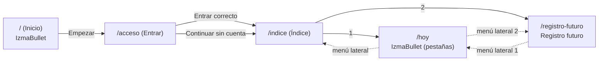

# Flujo de pantallas

Cómo se llega de la primera pantalla al Índice y a cada aplicación, y qué menú lateral se ve en cada una.
Describe lo que hay en el código. Boceto de origen: foto a mano del flujo (arranque → Login → Índice).

## Diagrama

Las flechas discontinuas son el menú lateral. Está disponible en el Índice y en las dos aplicaciones, con los mismos números.

## Pantallas

| Ruta | Archivo de ruta | Pantalla | Cabecera | Menú lateral |
|---|---|---|---|---|
| `/` | `src/app/index.js` | `src/pantallas/Inicio.js` | Oculta | No |
| `/acceso` | `src/app/acceso.js` | `src/pantallas/Acceso.js` | "Entrar" | No |
| `/indice` | `src/app/(app)/indice.js` | `src/pantallas/Indice.js` | Del menú lateral ("Índice") | Sí |
| `/hoy`, `/habitos`, `/objetivos`, `/ajustes` | `src/app/(app)/(tabs)/*.js` | Pantallas de IzmaBullet | Oculta (la pone el menú) | Sí |
| `/registro-futuro` | `src/app/(app)/registro-futuro.js` | `src/pantallas/RegistroFuturo.js` | "Registro futuro" | Sí |

Las pantallas de detalle y formulario (`/habito/...`, `/objetivo/...`, `/cuenta/...`) están fuera del menú lateral y vuelven atrás con el botón de cabecera.

### Inicio (`/`)
- Muestra el nombre "IzmaBullet" y el botón **Empezar**, que sustituye la pantalla por `/acceso`. Al sustituir, no queda una pantalla anterior a la que volver.

### Entrar (`/acceso`)
- Es el mismo formulario de Entrar (`src/pantallas/cuenta/Entrar.js`), con dos salidas que llevan a `/indice`:
  - **Entrar** con correo y contraseña correctos (pasa `alEntrar`).
  - **Continuar sin cuenta** (pasa `alSaltar`). Es la salida normal mientras no hay cuenta: la app funciona sin ella.
- Si la app se compiló sin Supabase, muestra "Cuenta no disponible" y solo el botón **Continuar sin cuenta**.

### Índice (`/indice`)
- Lista las aplicaciones de `src/dominio/aplicaciones.js` con su número. Pulsar una navega a su ruta.
- Números fijos: **1** IzmaBullet, **2** Registro futuro. Añadir una aplicación nueva es añadir una entrada a esa lista; el menú lateral y el Índice se actualizan solos.

### Menú lateral
- Lo define `src/app/(app)/_layout.js` con `expo-router/drawer`. Muestra "Índice" y luego cada aplicación con su número, por ejemplo `1  IzmaBullet`.
- Los números vienen de la misma lista (`etiquetaAplicacion`), así que el Índice y el menú no pueden desalinearse.

### Registro futuro (`/registro-futuro`)
- Aplicación 2. Dos páginas que se cambian deslizando el dedo de derecha a izquierda (`PAGINAS_FUTURO` en `src/dominio/futuro.js`):
  - **Registro**: Mes +1 y Mes +2.
  - **Futuro**: Mes +3 y Mes +4.
- Los meses se cuentan desde el mes actual y muestran su nombre real (`mesDesplazado`, por ejemplo "noviembre de 2026" para Mes +1 en octubre de 2026).
- Cada página tiene una columna de círculos a la derecha. Por ahora son solo visuales (`CIRCULOS_POR_PAGINA`): su función está pendiente de definir.
- La pestaña vertical **ÍNDICE** del borde izquierdo lleva al Índice.

## Notas de implementación

- La ruta de Hoy pasó de `index` a `hoy` porque `/` lo ocupa ahora la pantalla de Inicio.
- Las pestañas se movieron a `src/app/(app)/(tabs)/`. Los grupos entre paréntesis no cambian la URL, así que `/ajustes` y `/habito/[id]` siguen igual.
- El menú lateral necesita `react-native-drawer-layout`, `react-native-gesture-handler`, `react-native-reanimated` y `react-native-worklets`. Son módulos nativos: el build de desarrollo que tengas instalado probablemente no los incluye, así que hay que generar uno nuevo con EAS para verlo en el móvil. Con Jest y el bundle de Android no hace falta.

## Pendiente

- Diseño visual en Figma: el boceto está hecho a mano y no hay archivo de Figma.
- Qué muestra realmente la aplicación 2 cuando exista.
